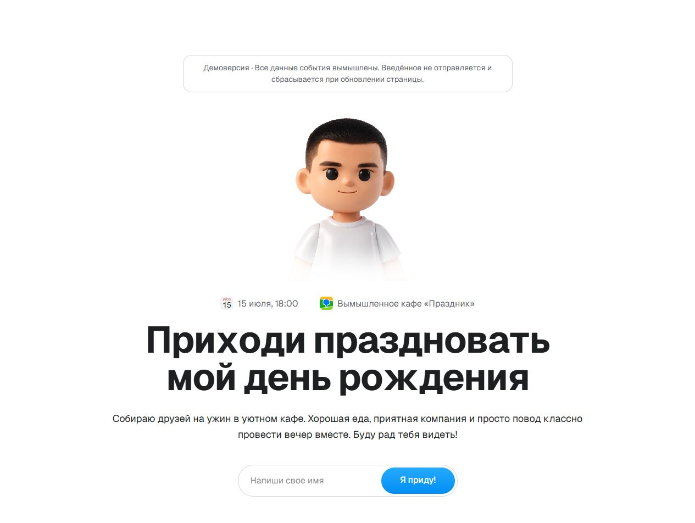

# Birthday Invitation

[](https://github.com/SpellbourneDZ/birthday-invitation-demo/actions/workflows/ci.yml)

[Создать свой сайт из шаблона](https://github.com/SpellbourneDZ/birthday-invitation-demo/generate) · [Настройка](#настройка) · [Публикация](#публикация)



Готовый шаблон интерактивного приглашения на день рождения с адаптивными экранами, видео с персонажем, выбором подарков и напитков, анимированным чеком и скачиванием PNG. Поддерживает клавиатуру, свайпы и системную настройку уменьшения анимации.

По умолчанию все данные события вымышлены. Персонаж и оформление оставлены с разрешения владельца.

Имя → подарок → напитки → анимированный чек. Ввод хранится только в памяти страницы, не отправляется на сервер и сбрасывается при обновлении. PNG создаётся локально и скачивается или передаётся через системное меню только по действию пользователя.

Нет API, админки, базы данных, аналитики, cookies, localStorage или sessionStorage. Обычные технические журналы хостинга могут включать обращения к страницам и ресурсам; содержимое формы в запросы не попадает.

## Быстрый старт

1. Нажмите **Use this template → Create a new repository**. Новый проект получит независимую историю. Можно выбрать private-репозиторий; содержимое опубликованного сайта всё равно будет доступно посетителям.
2. Установите Git и Node.js 22.13+ из линейки 22 LTS с npm.
3. Скачайте свой репозиторий, заменив `YOUR_USERNAME` и `YOUR_REPOSITORY`:

```sh
git clone https://github.com/YOUR_USERNAME/YOUR_REPOSITORY.git
cd YOUR_REPOSITORY
npm ci
npm run dev
```

Откройте адрес из вывода команды, обычно `http://localhost:3000`. Секреты и переменные окружения не нужны.

## Настройка

Все основные данные меняются в **[`lib/event.ts`](lib/event.ts)** и используются на главной странице и в чеке.

| Поле | Назначение |
| --- | --- |
| `pageTitle`, `pageDescription` | Заголовок вкладки и описание страницы |
| `hostGenitive` | Имя в родительном падеже: например, `Саши` |
| `dateLabel`, `dateFull`, `time` | Короткая дата, дата с годом и время |
| `calendarDay`, `calendarMonth`, `year` | День и месяц значка календаря, год чека |
| `location`, `mapUrl` | Место и необязательная HTTPS-ссылка на карту |
| `description`, `receiptFooter` | Текст приглашения и подпись чека |
| `wishlistTitle`, `wishlistDescription` | Содержимое окна о подарках |
| `wishlistImage`, `wishlistImageAlt` | Изображение окна и его описание |
| `demoNotice` | Плашка демоверсии; `""` скрывает её |

Обновите все варианты даты согласованно. Пустой `mapUrl` оставляет переход внутри страницы. Скрытие демоплашки не включает сбор ответов.

### Подарки, напитки и персонаж

- [`lib/gift-media.ts`](lib/gift-media.ts) — названия и изображения подарков. Их порядок задаёт `giftIds` в `app/page.tsx`.
- [`lib/drinks.ts`](lib/drinks.ts) — напитки, подписи и изображения.
- [`public/assets/`](public/assets/) — локальные ресурсы, доступные по путям `/assets/…`.
- Для своего персонажа замените постер `landing-raw-1.webp`, видео `landing-loop-optimized.mp4` и изображения `gift-*.webp`. Значение `landingLoop: null` в `lib/gift-media.ts` отключает видео и оставляет постер.
- `app/invitation.css` и `app/receipt.css` — оформление экранов и чека.

Не удаляйте ресурсы, пока на них ссылаются код или CSS. Демонстрационные материалы замените своими или получите разрешение на использование.

## Разработка

| Команда | Назначение |
| --- | --- |
| `npm run dev` | Локальная разработка |
| `npm test` | Тесты сценария и ограничений приватности |
| `npm run typecheck` | Проверка TypeScript |
| `npm run lint` | ESLint |
| `npm run build` | Production-сборка |
| `npm start` | Запуск собранной версии |

Стек: Next.js, React, TypeScript и CSS. Экспорт PNG — html2canvas; текстовая анимация — slot-text.

Issues и pull requests приветствуются. Перед PR запустите тесты, проверку типов, линтер и сборку. Для изменений интерфейса приложите скриншоты телефона и компьютера. Не включайте реальные данные гостей и секреты.

GitHub Actions автоматически запускает эти проверки при push в `main` и в pull requests. Секреты для проверок не требуются. После создания собственного репозитория замените ссылки на badge и кнопку шаблона в этом README, если хотите направлять их на свою копию.

## Публикация

Подходит хостинг с поддержкой Next.js или обычный сервер с Node.js. База данных не требуется.

### Любой Node.js-хостинг или свой сервер

```sh
npm ci
npm run build
npm start
```

Укажите корневую папку репозитория, сборку `npm run build` и запуск `npm start`. По умолчанию используется порт 3000; хостинг может задать свой через `PORT`. Домен и HTTPS настройте средствами хостинга или обратного прокси. На VPS используйте менеджер процессов или контейнер для постоянного запуска.

Для production нужны исходники, `public`, результат сборки `.next` и зависимости. Папка `public` сама по себе не является готовым сайтом.

### Vercel и другие платформы с интеграцией Next.js

Импортируйте свой GitHub-репозиторий, выберите Next.js, корень проекта и ветку публикации. Если нужны команды, укажите `npm ci` и `npm run build`. Папку результата определяет интеграция платформы; не задавайте `public` вручную.

На другой платформе используйте её инструкцию для версии Next.js из `package.json`. GitHub Pages и хостинги только для статических файлов не выполняют `npm start`; статический экспорт в этом шаблоне не настроен.

### Docker

```sh
docker build -t birthday-invitation .
docker run --rm -p 3000:3000 birthday-invitation
```

Откройте `http://localhost:3000`. Для публичного размещения подключите домен и HTTPS через инфраструктуру хостинга. Интернет нужен во время установки зависимостей и сборки шрифта Next.js.

### Layero

Создайте отдельный проект из этого репозитория, ветка `main`. Настройки Next.js и Node.js 22 указаны в `layero.json`. Не подключайте базу, аналитику или переменные окружения оригинального приглашения.

Репозиторий создан с новой историей и не является fork оригинального проекта.

### Перед отправкой гостям

Проверьте имя, дату, время, адрес, карту, изображения и скачанный PNG. Пройдите весь сценарий на телефоне. Не публикуйте данные, которые не хотите показывать посетителям.

## Приватность и ограничения

Автор приглашения не получает список участников и выбранные подарки. PNG создаётся в браузере и сохраняется или передаётся только по действию гостя. Хостинг может вести технические журналы; содержимое формы приложение в запросы не помещает. Подключённые вами аналитика и внешние сервисы могут изменить это поведение.

Сбор ответов, платежи и Wallet не реализованы. Для учёта участников понадобится отдельная реализация хранения и описание обработки данных.

## Лицензия

Исходный код — [MIT](LICENSE). Шрифты Geist — [OFL](public/assets/GEIST-OFL.txt). На демонстрационные изображения и видео в `public/assets/` лицензия MIT для кода не распространяется; используйте свои материалы или получите разрешение правообладателя. Лицензии сторонних библиотек сохраняются.
